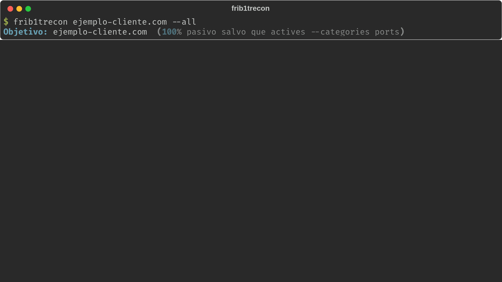

<p align="center">
  
</p>

<h1 align="center">frib1trecon</h1>

<p align="center">
  <strong>Reconocimiento OSINT pasivo para Linux</strong> — dorking, metadatos,
  leaks públicos, postura DNS/TLS, vulnerabilidades conocidas y typosquatting,
  con informes listos para entregar (TXT, Word, Excel, DOCX/LaTeX/PDF
  ejecutivo) y una interfaz web opcional.
</p>

<p align="center">
  
  
  
  
  
</p>

<p align="center">
  
</p>

<p align="center"><sub>Datos sintéticos de ejemplo — no corresponden a ningún dominio real.</sub></p>

---

## Estructura del repositorio

Este repositorio contiene dos proyectos hermanos, pensados para usarse juntos
pero con entornos virtuales independientes:

| Carpeta | Qué es | README |
|---|---|---|
| [`frib1trecon/`](frib1trecon/) | CLI: el motor de reconocimiento, instalador (`install.sh`) y generación de todos los informes | [frib1trecon/README.md](frib1trecon/README.md) |
| [`frib1trecon-web/`](frib1trecon-web/) | Interfaz web opcional (Flask) sobre el mismo motor — mismos informes, sin terminal | [frib1trecon-web/README.md](frib1trecon-web/README.md) |

`frib1trecon-web` importa directamente el motor de `frib1trecon` (no duplica
lógica ni comparte proceso), así que ambas carpetas deben vivir una al lado
de la otra, tal como están en este repo.

## Instalación rápida

```bash
git clone https://github.com/Frib1t/frib1trecon.git
cd frib1trecon/frib1trecon
# ^ el primer "frib1trecon" es el repo clonado; el segundo, la carpeta de la CLI
./install.sh
```

`install.sh` instala dependencias, levanta tu propia instancia de SearXNG
(Docker) y deja `frib1trecon-web/` lista si la carpeta existe junto a
`frib1trecon/` — ver cada README para el detalle completo (uso, categorías,
API keys opcionales, interfaz web).

## Licencia

[Apache License 2.0](LICENSE).
